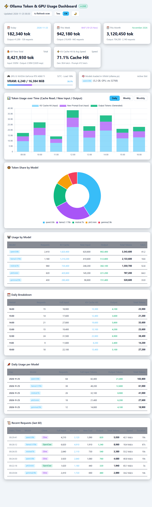

# ⚡ Ollama Token & GPU Usage Dashboard

A lightweight, single-page dashboard that tracks **token usage** and **GPU/VRAM stats** for a local [Ollama](https://ollama.com) server. It parses Ollama's log files to build a SQLite history of every request (input/output/cached tokens, prompt & generation speed), then serves a live web UI.

No framework, no build step — just **Node.js** for the backend and one **HTML** file for the frontend.

| Dark theme | Light theme |
|:---:|:---:|
|  |  |

> English UI (language toggle): 

## Features

- **KPI cards** — tokens for today / this week / this month / all-time, cache-hit rate, and average prompt & generation speed.
- **Live GPU panel** — per-GPU VRAM usage (with progress bar), temperature, and utilization, plus the currently loaded model(s) from `ollama ps`.
- **Time-series chart** — stacked bars of cached / evaluated / output tokens, switchable between **Day · Week · Month**.
- **Model breakdown** — doughnut chart + table of token usage per model.
- **Recent requests** — a live feed of the latest calls with per-request token counts and speed.
- **🌐 Language toggle (TH | EN)** — switch the entire UI between Thai and English; preference is remembered in `localStorage`.
- **🌙 Dark / ☀️ Light theme** — one-click theme switch, also persisted in `localStorage` (defaults to dark).

## How it works

```
Ollama log files  ──parse──▶  SQLite (usage.db)  ──/api/stats──▶  index.html (Chart.js)
        │                          ▲
        └── nvidia-smi / ollama ps ┘   (live GPU + loaded models)
```

- `server.js` — an HTTP server (port **8799**) that tails Ollama's logs, stores each request in a local SQLite database, and exposes a single `GET /api/stats` endpoint returning the aggregated JSON the UI renders.
- `index.html` — the dashboard. It polls `/api/stats` every 15 s and renders KPIs, charts (Chart.js), and tables. All i18n strings and theme colors live in this one file.

## Requirements

- **Node.js ≥ 22** (uses the built-in `node:sqlite` module — no `npm install` needed)
- **Ollama** running locally (the dashboard reads its logs and calls `ollama ps`)
- **nvidia-smi** on PATH (for GPU stats; NVIDIA only)

## Getting started

```bash
git clone <your-repo-url> ollama-dashboard
cd ollama-dashboard
node server.js
```

Then open **http://localhost:8799** in your browser.

The server creates `usage.db` automatically on first run (next to `server.js`).

### Configuration (environment variables)

All filesystem paths and the port are configurable — **no hardcoded user names or machine-specific paths** in the source. Defaults are sensible for a standard install; override via env vars if needed:

| Variable | Default | Description |
|---|---|---|
| `DASH_PORT` | `8799` | HTTP port to listen on |
| `DASH_DATA_DIR` | `<home>/ollama-dashboard` | Where `usage.db` is stored |
| `OLLAMA_LOG_DIR` | `%LOCALAPPDATA%/Ollama` (Win) | Directory containing Ollama's log files |
| `OLLAMA_MANIFEST_DIR` | `<home>/.ollama/models/manifests` | Ollama model manifest directory |
| `OLLAMA_BIN` | `ollama` (or the common Windows install path) | Path to the `ollama` executable |

Example:

```bash
# Linux / macOS
OLLAMA_LOG_DIR="$HOME/.ollama/logs" DASH_PORT=9000 node server.js

# Windows (PowerShell)
$env:DASH_PORT="9000"; node server.js
```

## Project structure

```
ollama-dashboard/
├── index.html        # The dashboard UI (single file: HTML + CSS + JS + i18n + theme)
├── server.js         # Node HTTP server + log parser + SQLite store + /api/stats
├── mock_server.py    # Optional: tiny Python server that serves the UI with sample data
├── mock_data.json    # Sample /api/stats payload used by mock_server.py (for previews)
├── .gitignore        # Excludes usage.db, logs, backups
└── docs/
    ├── screenshot-dark.png
    ├── screenshot-light.png
    └── screenshot-en.png
```

### Previewing without Ollama

To see the UI with sample data (no Ollama required), run the bundled mock server:

```bash
python mock_server.py   # serves http://localhost:8799 with mock_data.json
```

## Privacy & data

- All data stays **local** — nothing is sent to any external service.
- `usage.db` contains your real usage history and is **git-ignored** by design. Never commit it.
- The `docs/` screenshots use **synthetic sample data** only (no real tokens, IPs, or usernames).

## License

MIT — see [LICENSE](LICENSE).
