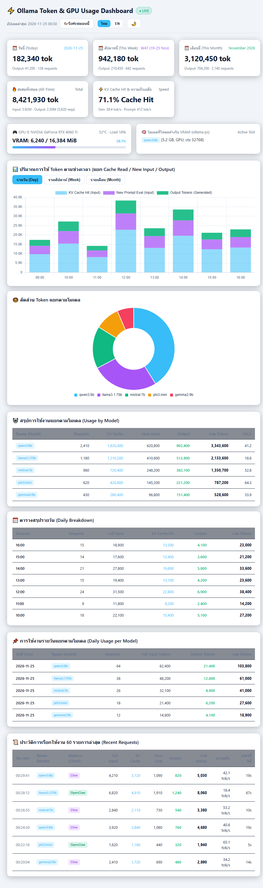
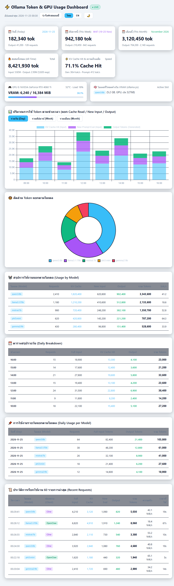

# ⚡ Ollama Token & GPU Usage Dashboard

Dashboard แบบ single-page เบาๆ สำหรับติดตาม **การใช้ token** และ **สถิติ GPU/VRAM** ของ [Ollama](https://ollama.com) บนเครื่องท้องถิ่น โดย parse ไฟล์ log ของ Ollama มาสร้างฐานข้อมูล SQLite สถิติ request ทุกครั้ง (input/output/cached tokens, ความเร็ว prompt & generation) แล้วเสิร์ฟ UI ทางเว็บ

ไม่มี framework ไม่มี build step — ใช้แค่ **Node.js** สำหรับ backend และ **HTML** ไฟล์เดียวสำหรับ frontend

| Dark theme | Light theme |
|:---:|:---:|
|  |  |

> UI ภาษาอังกฤษ (มี language toggle): 

## หน้าที่

- **KPI cards** — token ของวันนี้ / สัปดาห์นี้ / เดือนนี้ / รวมทั้งหมด, cache-hit rate, ความเร็ว prompt & generation โดยเฉลี่ย
- **Live GPU panel** — VRAM ใช้งานต่อ GPU (พร้อม progress bar), อุณหภูมิ, utilization พร้อม model ที่ load อยู่จาก `ollama ps`
- **Time-series chart** — stacked bars ของ cached / evaluated / output tokens สลับระหว่าง **วัน · สัปดาห์ · เดือน**
- **Model breakdown** — doughnut chart + ตาราง token usage ต่อ model
- **Recent requests** — feed request ล่าสุดพร้อม token counts & ความเร็วต่อ request
- **🌐 Language toggle (TH | EN)** — สลับ UI ทั้งหมดระหว่างไทย/อังกฤษ จำ preference ใน `localStorage`
- **🌙 Dark / ☀️ Light theme** — สลับหนึ่งคลิก จำใน `localStorage` (default เป็น dark)

## วิธีทำงาน

```
Ollama log files  ──parse──▶  SQLite (usage.db)  ──/api/stats──▶  index.html (Chart.js)
        │                          ▲
        └── nvidia-smi / ollama ps ┘   (live GPU + loaded models)
```

- `server.js` — HTTP server (port **8799**) ที่ติดตาม log ของ Ollama, บันทึก request ทุกรูปลง SQLite, และเปิด endpoint เดียว `GET /api/stats` คืน JSON รวมที่ UI ใช้ render
- `index.html` — dashboard poll `/api/stats` ทุก 15 วินาที ให้ KPI, charts (Chart.js), ตาราง — i18n strings & สีนั้น theme อยู่ในไฟล์เดียว

## Requirements

- **Node.js ≥ 22** (ใช้ `node:sqlite` module ในตัว — ไม่ต้อง `npm install`)
- **Ollama** รันอยู่บนเครื่อง (dashboard ต้องการ log ของมัน + ใช้ `ollama ps`)
- **nvidia-smi** ใน PATH (สำหรับ GPU stats; NVIDIA เท่านั้น)

## เริ่มใช้งาน

```bash
git clone <repo-url> ollama-dashboard
cd ollama-dashboard
node server.js
```

จากนั้นเปิด **http://localhost:8799** ใน browser

server จะสร้าง `usage.db` อัตโนมัติในครั้งแรก (อยู่ข้างๆ `server.js`)

### Configuration (environment variables)

ทุก path & port ปรับได้ — **ไม่มี hardcoded username หรือ machine-specific paths ใน source** default เหมาะกับ standard install; ปรับผ่าน env vars ถ้าจำเป็น:

| Variable | Default | คำอธิบาย |
|---|---|---|
| `DASH_PORT` | `8799` | HTTP port ที่จะ listen |
| `DASH_DATA_DIR` | `<home>/ollama-dashboard` | ที่เก็บ `usage.db` |
| `OLLAMA_LOG_DIR` | `%LOCALAPPDATA%/Ollama` (Win) | ที่อยู่ log files ของ Ollama |
| `OLLAMA_MANIFEST_DIR` | `<home>/.ollama/models/manifests` | Model manifest directory ของ Ollama |
| `OLLAMA_BIN` | `ollama` (หรือ Windows install path ทั่วไป) | Path ไปยัง executable `ollama` |

ตัวอย่าง:

```bash
# Linux / macOS
OLLAMA_LOG_DIR="$HOME/.ollama/logs" DASH_PORT=9000 node server.js

# Windows (PowerShell)
$env:DASH_PORT="9000"; node server.js
```

## โครงสร้างโปรเจกต์

```
ollama-dashboard/
├── index.html        # Dashboard UI (ไฟล์เดียว: HTML + CSS + JS + i18n + theme)
├── server.js         # Node HTTP server + log parser + SQLite store + /api/stats
├── mock_server.py    # Optional: Python server เล็กๆ ที่เสิร์ฟ UI พร้อม sample data
├── mock_data.json    # Sample /api/stats payload ที่ mock_server.py ใช้ (สำหรับ preview)
├── .gitignore        # Exclude usage.db, logs, backups
└── docs/
    ├── screenshot-dark.png
    ├── screenshot-light.png
    └── screenshot-en.png
```

### Preview โดยไม่ต้อง Ollama

อยากเห็น UI พร้อม sample data (ไม่ต้อง Ollama) รัน mock server ที่แนบมากับโปรเจกต์:

```bash
python mock_server.py   # เสิร์ฟ http://localhost:8799 พร้อม mock_data.json
```

## Privacy & ข้อมูล

- ข้อมูลทุกอย่างอยู่ **บนเครื่อง** — ไม่ส่งไป external service ใด
- `usage.db` มี usage history จริงของคุณ และ **git-ignored** โดย design — ห้าม commit
- Screenshot ใน `docs/` ใช้ **synthetic sample data** เท่านั้น (ไม่มี token, IP, username จริง)

## License

MIT — ดู [LICENSE](LICENSE)
